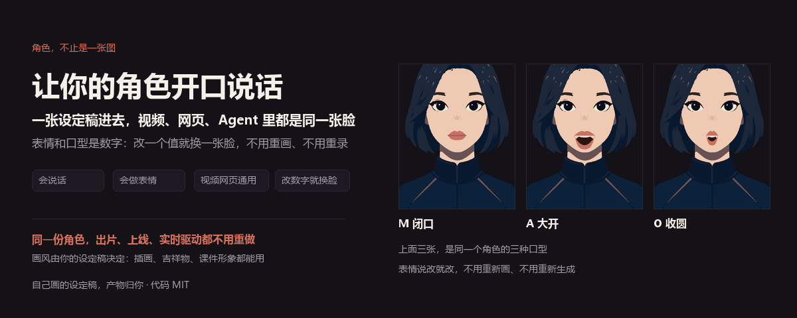

# codeavatar

[中文](README.md) | **English**



> **Give your character design a face that moves.** One character can speak and show
> expression, and it is the *same face* in narrated videos, on a web page, and inside an
> Agent's reply. Expressions and mouth shapes are numbers — change one value and the face
> changes, with no redrawing and no re-recording.

Change the line, the mood, or the timing of a mouth shape by editing data. You can see
exactly what changed and roll back at any time. The art style comes from your own design
sheet — an illustration, a brand mascot, or a courseware character.

## See it first (install nothing)

**[Live demo — open it in your browser](https://codeavatar-runtime-demo.app.workbuddy.host/?sharecode=4PW2T4UUBH)** —
no sign-up, no install. Switch between 6 mouth shapes / 3 moods and watch the face change,
or type a sentence and let the character speak (browser-local TTS, no network).

The same page also lives in the repo: [`demo/runtime.html`](demo/runtime.html), a
**single 1.1 MB HTML file** you can double-click after cloning — it works offline, with
18 pre-rendered SVG frames built in.

> For a local HTTP preview: `python -m http.server 8000` →
> `http://localhost:8000/demo/runtime.html`. Small note: jsDelivr serves `.html` from a
> repo as `text/plain`, so the CDN is only for `standalone.js`; use the hosted link above
> for the full page.


> Honest note: the demo's "speaking" is a rhythmic carousel, **not phoneme alignment**.
> For a real video where the mouth lands on the spoken words, the repo's `aligned` mode
> drives mouth shapes from word-level timestamps and renders the clip with its audio track.

## Put it in your own page

The runtime is built and verified; the artifacts are in
[`packages/avatar-runtime/dist/`](packages/avatar-runtime/dist/).

```js
import { renderFaceSvg, NEUTRAL, VISEME } from 'codeavatar-runtime';

const pose = { ...NEUTRAL, ...VISEME.A };          // want it to open its mouth? change this
document.querySelector('#stage').innerHTML =
  renderFaceSvg(charJson, pose, { transparentBg: true });   // charJson = your own character
```

```html
<!-- No install: use the CDN script directly -->
<script src="https://cdn.jsdelivr.net/gh/ch0712/codeavatar@master/packages/avatar-runtime/dist/standalone.js"></script>
<script>
  const svg = CodeAvatar.renderFaceSvg(CHAR, {
    ...CodeAvatar.NEUTRAL, ...CodeAvatar.VISEME.O
  });
  document.querySelector('#stage').innerHTML = svg;
</script>
```

**Release status (stated plainly)**: the package layout, all three entry points (ESM / CJS /
CDN) and the verification chain are ready, but `codeavatar-runtime` is **not yet published
to npm**. Until then use `npm pack ./packages/avatar-runtime`, the in-repo `dist/` files,
or the CDN link above.

To rebuild and verify it yourself:
`node packages/avatar-runtime/scripts/build.mjs && node packages/avatar-runtime/scripts/verify.mjs`
(compares the built output against the reference frames so nothing drifts).

`charJson` is supplied by you. The runtime **intentionally ships no character data**: the
character artwork has a different licence and cannot be redistributed inside an MIT package;
anything you generate from a sheet you drew is yours. See [Where characters come from](#usage)
and [License](#license).

## How directly you can change things

| What you want to do | The usual way | Here |
|:--|:--|:--|
| Change an expression | regenerate a clip / redraw a frame | change one number, see it at once |
| Produce 100 narrated clips | run and check them one by one | batch from the same character data, identical every time |
| Put the character in a page or app | stand up an inference service, or export another asset set | drop a frame straight in |
| Use one character across video / web / Agent | keep several copies, edit each one | one file, the same face everywhere |
| Roll back a bad edit | re-run and hope | the diff shows which expression changed; go back at any time |

**About the visual grade, up front**: this is flat illustration, not photoreal. Good for
picture-in-picture narration, product guides, a visible face for an Agent, courseware and
private deployments; not for a cinematic full-screen protagonist. **If a heavier technical
stack makes the result better, we will use it** — how it works today is a trade-off, not a
limit, and we will not hold on to a technical label at the cost of the picture.

## Capability boundary (honest notes)

| Works | Does not work |
|:--|:--|
| Parameterised **mouth / expression / brow** animation for illustration-grade characters | Photoreal humans (that is the domain of GPU lip-sync models) |
| Automatic tracing from a reference sheet in `auto` zone mode | Creating planes the sheet never drew (no separate nostril patch → no nose) |
| Standalone talking-head video (picture / lip-sync / captions) | Full-screen hero art (picture-in-picture and medium shots are the comfort zone) |
| The same face in video and on the web — not two different looks | Phoneme-aligned lip-sync from raw Chinese text (needs pinyin or word timestamps) |

Measured grade: **flat illustration**. Good enough for a PiP narrator or a vertical talking head.

> **One correction to earlier docs**: we used to claim "zero manual work to switch characters".
> In reality `auto` zoning works without manual input on clean sheets, while the full-lip
> character `noF` currently uses **hand-measured five-zone PRESETS**. Turning that into a
> browser point-and-click annotation step is tracked as P1 in
> [`docs/BREAKTHROUGH-2026-11.md`](docs/BREAKTHROUGH-2026-11.md). If swapping in your own
> sheet does not work out of the box, that is a gap on our side, not a mistake on yours.

## Layout

```
packages/anchor-core/     TS capability package (single source of truth)
  src/types.ts              contract: 16 pose channels / 6 visemes / 5 moods
  src/FaceTraced.tsx        parameterised face renderer (pure SVG, no textures) ★ only renderer
  src/svg.ts                SSR adapter: renderFaceSvg → SVG string
  src/perf.ts               perf.json → per-frame Pose (deterministic)
  src/chars/*.json          character data (trace output, one file per character)
  src/chars/index.ts        auto-generated character registry
  scripts/check_boundaries.py   cross-platform package boundary check (run before extraction / publishing)
packages/avatar-runtime/   distributable runtime (ESM / CJS / CDN)
  dist/index.mjs | index.cjs | standalone.js | index.d.ts
demo/runtime.html          single-file demo (open it and the character speaks)
studio/                   Remotion project (talking-head output)
tools/                    Python toolchain
  sheet_gate.py             reference sheet compliance gate
  zone_auto.py              automatic facial-zone localisation (structural landmarks)
  trace_design.py           layered tracing (auto mode, zero manual work)
  split_eye_layers.py       eye layer split into lid / iris (iris geometry solved automatically)
  curve_fit.py              contour curve fitting
  gate_mouth.py             6-viseme gate (amplitude / separability)
  gate_structure.py         structure gate (missing / malformed parts)
  gate_layer_roles.py       layer role gate
  gate_film_perf.py         film-level performance gate (mouth overflow / closed-lip ratio)
  validate_perf.py          Perf contract validation (reads schema/perf-contract.json)
  cli_check.py              CLI exit-code / dry-run / structured-output assertions
  eval_kit.py               human-eval kit builder (6 blind-ordered clips / questionnaire / key)
  eval_score.py             human-eval aggregation and protocol verdict
  tts.py                    TTS audio (edge-tts default / pyttsx3 offline fallback)
  tts_volc.py               Volcengine Doubao TTS 2.0 (word timestamps for aligned mode)
  codeavatar.py             unified CLI
  runtime_parity_check.py   visual-equivalence gate for the runtime
  make_assets.py            README visual asset generator
docs/SPEC.md              hard spec for reference sheets (with negative list)
docs/TIMING.md            sampling / interpolation / event tracks / track blending spec (assertion evidence per rule)
docs/BREAKTHROUGH-2026-11.md   breakthrough roadmap and reasoning
docs/INTEGRATION.md       third-party integration contract
docs/CHANGELOG-char-automation.md   measured log and pitfalls of the automation work
docs/LICENSES.md          licensing (code MIT / character assets / third-party split)
CONTRIBUTING.md           contribution guide (pre-commit gates / four hard rules / PR bar)
SECURITY.md               security policy and private reporting channel
```

## Contracts and single source of truth

- **One renderer**: `FaceTraced.tsx`. SSR, film output, demo and the distributable package
  all reuse it; a second renderer is not allowed. `tools/runtime_parity_check.py` enforces
  this with two images from the same render pipeline, compared pixel by pixel
  (currently `noF`: 0 / 3,072,000 differing pixels).
- **Pose ranges**: the single source of truth is `POSE_RANGES` in `packages/anchor-core/src/types.ts`
  (a machine-checkable constant; the renderer clamp and the schema validator both read it).
  Previously it was a comment-level convention that disagreed with actual behaviour
  (brow documented as 0..1 but rendered as -1..1.15); it is now "comment = contract = render behaviour".
- **Perf contract**: `packages/anchor-core/schema/perf-contract.json` (generated from TS constants by
  `scripts/schema-dump.ts` and committed; CI asserts it stays byte-identical). TS `validatePerf()`
  and Python `tools/validate_perf.py` read **the same file** — the two languages must not each keep
  their own range table.
- **Codegen boundary**: `src/chars/index.ts` is an auto-generated registry, never edit it by hand.
  Character data `src/chars/*.json` is produced by the `build` pipeline; only the toolchain writes it.
- **Exit codes**: stable CLI codes `0` success / `2` invalid input or contract violation /
  `3` missing environment. With `--json`, stdout carries only machine-readable JSON and diagnostics
  go to stderr.

```bash
# contract validation (blocks out-of-contract values before rendering; explicit error, no silent clamp)
python tools/validate_perf.py out/perf.json

# dry-run: synthesis + contract validation + path check, no render (for CI / third-party integration)
python tools/codeavatar.py render no4 -o out/clip.mp4 --props out/perf.json --dry-run --json
```

## Usage

```bash
# install dependencies first (Windows and Linux)
python -m pip install -r requirements.txt
npm ci

# 1) gate a reference sheet (non-compliance names the exact rule that failed)
python tools/codeavatar.py gate examples/sheet-S5.png

# 2) one command to produce a character (gate → trace → eye layer split)
python tools/codeavatar.py build examples/sheet-S5.png demo

# 3) 6-viseme sheet + machine check
python tools/codeavatar.py grid no4

# 4) talking-head clip
python tools/codeavatar.py render no4 -o out/clip.mp4 --props examples/perf.json

# 4b) text straight to clip (deterministic synthesis)
python tools/codeavatar.py say no4 "da4 jia1 hao3! jin1 tian1 jiang3 kou3 xing2." \
    -o out/talk.mp4 --pinyin --coarticulate   # pinyin: visemes map to phonemes
python tools/codeavatar.py say no4 "大家好，今天讲口型。" \
    -o out/talk.mp4                            # Chinese: rhythm estimation (honest
                                               # degradation, perf.meta.mode=estimated,
                                               # visemes not guaranteed to match phonemes)

# 4b+) talking-head clip with sound (TTS audio track + duration alignment)
python tools/tts.py "大家好，今天讲口型。" -o out/tts.mp3
python tools/codeavatar.py say no4 "大家好，今天讲口型。" \
    -o out/talk.mp4 --audio out/tts.mp3        # aligns syllable rate to the audio
                                               # duration and muxes it (first-order
                                               # total-duration alignment, not per-phoneme;
                                               # pass --no-align to disable)

# 4b++) per-character alignment (recommended): the upstream supplies word timestamps,
# so the mouth lands on the real speech moments
python tools/tts_volc.py "今天讲一下口型同步的具体做法。" -o out/tts-volc   # Volcengine Doubao TTS
python tools/codeavatar.py say no4 "jin1 tian1 jiang3 yi2 xia4 kou3 xing2 tong2 bu4 de5 ju4 ti3 zuo4 fa3." \
    -o out/talk.mp4 --pinyin --motion --coarticulate \
    --audio out/tts-volc/voice.mp3 --words out/tts-volc/words.json
#   --words selects aligned mode: frame positions come from seconds, not from an
#   average speech rate; the mouth stays closed before the first word and in gaps,
#   and sentence-final punctuation drives the intent track. The pinyin must match
#   the spoken text syllable by syllable (a count mismatch is a hard error).
#   Credentials are read only from VOLC_TTS_API_KEY or a repo-root .volc.env (not committed).
python tools/codeavatar.py say no4 "ni3 hao3!" \
    -o out/talk.mp4 --pinyin --motion          # + low-amplitude motion tracks: gaze target /
                                               # blink rhythm / head anticipation-follow-settle /
                                               # breathing (explicit opt-in, off by default so
                                               # accepted characters stay byte-stable)
# Character style coordination (amplitude gains / track switches / head-gaze coupling / locked
# tracks) goes through JSON:
#   echo '{"text":"ni3 hao3!","pinyin":true,"style":{"gazeGain":1.1,
#         "headGain":1.3,"headGazeCouple":0.3}}' | python tools/say_perf.py
#   → consume out/perf.json via render --props; a locked track in style replaces the
#   auto-generated motion wholesale; same parameters + same seed replay byte-identically.

# 4c) shot size (framing presets, explicit opt-in, default full keeps output byte-stable)
#   --shot full    full body (zoom 1.0, anchorY 0.45)
#   --shot medium  medium shot (zoom 1.35, anchorY 0.62)
#   --shot closeup close-up (zoom 1.9, anchorY 0.72)
#   Renderer props also accept shot="medium" or explicit zoom/anchorY.
python tools/codeavatar.py render no4 -o out/medium.mp4 --props examples/perf.json --shot medium

# 5) which characters exist
python tools/codeavatar.py list
```

Windows and Linux are supported. Requires Python 3.11, Node.js 20, FFmpeg and the project's Python dependencies; run `npm ci` at the repository root to install the locked JavaScript dependencies. Check Remotion 4.0.537's commercial licensing terms against their current wording.

## Two hard rules

1. **Character data exists in exactly one place**, `packages/anchor-core/src/chars/`. The toolchain reads and writes it; consumers read only. `python packages/anchor-core/scripts/check_boundaries.py` enforces this by machine.
2. **No silent degradation.** Output for an accepted character must be reproducible field by field; any heuristic that "only applies to some sheets" must be an explicit switch (e.g. `FOLK_NOISE_FLATTEN=1`), with the default path kept byte-stable.

## License

**Code is MIT** (see `LICENSE`): commercial use, closed-source derivatives and redistribution are allowed; keep the copyright notice.

Two categories are **not** covered by MIT, see `docs/LICENSES.md`:

- **Character art assets** (`chars/*.json`, the reference sheets under `examples/`, the sample
  frames embedded in `demo/runtime.html` and the sample images under `docs/assets/`) are all
  rights reserved, provided as pipeline samples only; no commercial use or redistribution.
  Products generated from your own sheets are yours and are not restricted by this clause.
  This is also why `codeavatar-runtime` ships no character data; the page code and the runtime
  package themselves remain MIT.
- **Third-party dependencies keep their own terms.** Remotion 4.x is dual-licensed — companies
  beyond the size limit must buy a commercial licence. This repository's MIT **cannot** satisfy
  Remotion's licensing requirements on your behalf.

## Provenance

This repository was extracted from autocut (the `anchor-code` subsystem under `refs/dhk`).
The acceptance bar for the extraction was: both consumers (the dhk film and the film free channel)
produce **byte-identical** still frames before and after the change.
See `docs/CHANGELOG-char-automation.md`.

## Mirror

- GitHub (public): https://github.com/ch0712/codeavatar
