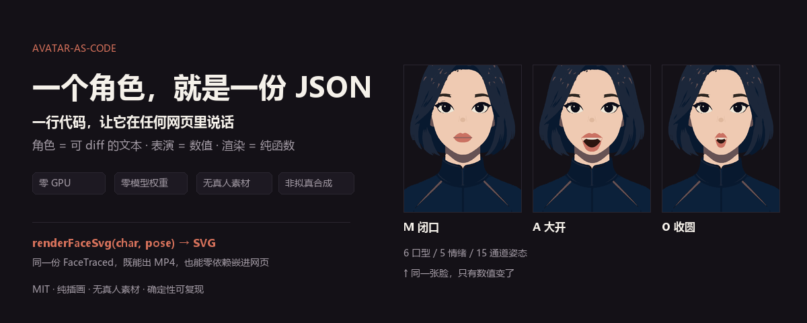

# codeavatar

**中文** | [English](README.en.md)



> **Avatar-as-Code**：一个角色就是一份可 diff 的 JSON，表演是一组数值，渲染是一个纯函数。
> 一行代码让它在任何网页里说话 —— 零 GPU、零模型权重、无真人素材、非拟真合成。

这不是又一个「AI 数字人生成视频」项目。**角色是纯文本、表演是数字、画面是 SVG**，
所以它可以进 git、进 CI、进网页、进 Agent，且每次渲染逐字节可复现。

## 先看效果（不用装任何东西）

**[在线 demo：点开即看](https://codeavatar-runtime-demo.app.workbuddy.host/?sharecode=4PW2T4UUBH)** —
浏览器直接打开，无需注册、无需安装。可以切换 6 种口型 / 3 种情绪，输入一句话让角色开口
（浏览器本地语音合成）。

同一个页面也在仓库里：[`demo/runtime.html`](demo/runtime.html)，一个 **1.1 MB 的单文件 HTML**：
clone 后双击打开即可，不需要起服务、不需要联网。页面里没有 React、没有 Remotion、
没有构建步骤，只有 18 帧预渲染的 SVG。

> 本地 HTTP 预览：`python -m http.server 8000` → `http://localhost:8000/demo/runtime.html`。
> 注意 CDN 上的 `standalone.js` 是 JS 运行时（可正常引用），但 jsDelivr 会以
> `text/plain` 返回 HTML 文件，**不能用 CDN 链接直接当页面打开**；在线页面请用上面的托管链接。


> 诚实标注：demo 里的「说话」是节奏轮播，**不是音素级对齐**。仓库里的 `aligned` 模式
> 用字级时间戳驱动口型，用于真实成片。这个 demo 证明的是**渲染器可以脱离视频管线独立工作**。

## 30 秒接入

运行时已经构建并通过验收，产物在 [`packages/avatar-runtime/dist/`](packages/avatar-runtime/dist/)。

```js
// Node / bundler（ESM 或 CJS 均可，运行时零依赖）
import { renderFaceSvg, NEUTRAL, VISEME } from 'codeavatar-runtime';

const pose = { ...NEUTRAL, ...VISEME.A };          // 表演 = 数值
document.querySelector('#stage').innerHTML =
  renderFaceSvg(charJson, pose, { transparentBg: true });   // 角色 = 你自己的 JSON
```

```html
<!-- 浏览器免构建：standalone 挂到 window.CodeAvatar -->
<script src="https://cdn.jsdelivr.net/gh/ch0712/codeavatar@master/packages/avatar-runtime/dist/standalone.js"></script>
<script>
  const svg = CodeAvatar.renderFaceSvg(CHAR, {
    ...CodeAvatar.NEUTRAL, ...CodeAvatar.VISEME.O
  });
  document.querySelector('#stage').innerHTML = svg;
</script>
```

**发布状态（如实说明）**：`codeavatar-runtime` 的包结构、三种入口（ESM / CJS / CDN）
与验收链都已就绪，**尚未推送到 npm registry**。当前可用的安装方式：

```bash
npm pack ./packages/avatar-runtime     # 生成 tgz 后 npm i ./codeavatar-runtime-0.2.0.tgz
# 或直接引用仓库内的 dist/ 文件与上面的 CDN 链接
```

运行 `node packages/avatar-runtime/scripts/build.mjs && node packages/avatar-runtime/scripts/verify.mjs`
可重新构建并自检；`verify.mjs` 会把产物渲染的 SVG 与**已通过 Remotion 逐像素校验**的 SSR 帧
逐字节比对，确保发布产物没有偷偷漂移。

`charJson` 由调用方提供。运行包刻意**不内置任何角色数据**：角色美术资产的授权与代码不同，
不能随 MIT 包再分发；你自己画的设定稿跑 `build` 生成的产物归你所有。
详见[角色从哪来](#角色从哪来)与[授权](#授权)。

## 为什么是另一条路

2026 年做「会说话的人」大多是 GPU 路线：扩散说话头、口型重绘、3DGS 驱动。它们画质更高，
但也带来模型权重、显存、许可尽调、真人肖像/声纹授权与生成内容标识义务。
codeavatar 走的是完全不同的形状：

| | GPU 说话头 / 数字人平台 | codeavatar |
|:--|:--|:--|
| 角色是什么 | 模型权重 / 真人视频 / 3D 资产 | **一份可 diff 的 JSON** |
| 表演是什么 | 推理结果 / 关键帧绑定 | **一组数值**（15 通道 Pose / 6 口型 / 5 情绪） |
| 渲染 | GPU 推理，逐帧生成 | **纯函数 → SVG 字符串**，CPU 毫秒级 |
| 可复现 | 同输入不保证同输出 | **同输入逐字节同输出**，可进 CI |
| 可嵌入网页 | 需要服务端或 WASM 推理 | **零依赖 SVG，直接 innerHTML** |
| 素材与合规 | 真人肖像 / 声纹 / 权重许可 / AI 标识 | 纯插画、无真人素材、不生成拟真人脸 |

**代价说在前面**：它是扁平插画级，不是写实。适合做画中画解说、产品引导、Agent 的可视化身、
课件与私有化场景；不适合当电影级全屏主角。

## 能力边界（诚实标注）

| 能 | 不能 |
|:--|:--|
| 插画级角色的**口型/表情/眉眼**参数化动画 | 真人级写实（那是 GPU 口型驱动模型的领域） |
| `auto` 分区下从设定稿自动描摹出角色 | 造出设定稿里没有画的平面（如鼻翼没有独立色块 → 就没有鼻子） |
| 独立输出口播视频（画面/口型/字幕） | 全屏主体级美术（画中画/中等景别是舒适区） |
| 同级 SSR 与 Remotion 成片渲染**逐像素一致** | 中文文本直接出音素级对齐口型（需拼音或字级时间戳） |

实测档次：**扁平插画级**。

> **一处必须说清的现状**：早期文档写过「换角色零人工」。实际是 `trace_design.py` 的
> `auto` 分区对结构清晰的稿子零人工，而厚唇女性角色 `noF` 目前用的是**手量五区 PRESETS**。
> 把这一步变成浏览器点选式标注（P1）已列在[突破路线](docs/BREAKTHROUGH-2026-11.md)里，
> 在它完成之前，复杂设定稿仍需人工量一次五区。照着 README 直接换稿不成功，不是你操作错了。

## 角色从哪来

```bash
python -m pip install -r requirements.txt
npm ci

python tools/codeavatar.py gate examples/sheet-S5.png          # 设定稿合规闸门
python tools/codeavatar.py build examples/sheet-S5.png demo    # gate → 描摹 → 眼层拆分
python tools/codeavatar.py grid demo                          # 六格口型表 + 机检
python tools/codeavatar.py list                               # 已注册角色
```

产物是 `packages/anchor-core/src/chars/{key}.json`：一份纯文本，含画布、五官分区、
描摹图层与唇色。`renderFaceSvg` 只认这份 JSON，不认图片、不认模型。

## 出成片（完整工具链）

```bash
# 文本直接成片（确定性合成）
python tools/codeavatar.py say no4 "da4 jia1 hao3! jin1 tian1 jiang3 kou3 xing2." \
    -o out/talk.mp4 --pinyin --coarticulate
python tools/codeavatar.py say no4 "大家好，今天讲口型。" \
    -o out/talk.mp4                       # 中文：节奏估计（诚实降级，perf.meta.mode=estimated）

# 带声音
python tools/tts.py "大家好，今天讲口型。" -o out/tts.mp3
python tools/codeavatar.py say no4 "大家好，今天讲口型。" \
    -o out/talk.mp4 --audio out/tts.mp3

# 逐字对齐（推荐）：上游给字级时间戳
python tools/tts_volc.py "今天讲一下口型同步的具体做法。" -o out/tts-volc
python tools/codeavatar.py say no4 "jin1 tian1 jiang3 yi2 xia4 kou3 xing2 tong2 bu4 de5 ju4 ti3 zuo4 fa3." \
    -o out/talk.mp4 --pinyin --motion --coarticulate \
    --audio out/tts-volc/voice.mp3 --words out/tts-volc/words.json

# 镜头景别：--shot full | medium | closeup（缺省 full，零漂移）
python tools/codeavatar.py render no4 -o out/medium.mp4 --props examples/perf.json --shot medium
# 契约校验 / dry-run / 结构化输出
python tools/validate_perf.py out/perf.json
python tools/codeavatar.py render no4 -o out/clip.mp4 --props out/perf.json --dry-run --json
```

更多（情绪风格、动作轨、perf 契约、第三方集成）见 [`docs/INTEGRATION.md`](docs/INTEGRATION.md)。
支持 Windows 和 Linux；需要 Python 3.11、Node.js 20、FFmpeg 与 Remotion 依赖，
在仓库根目录运行 `npm ci`。Remotion 4.0.537 的商业授权要求请按其当前条款核对。

## 目录

```
packages/anchor-core/     TS 能力包（唯一事实源）
  src/types.ts              契约：Pose 15 参数 / 6 口型 / 5 情绪
  src/FaceTraced.tsx        参数化脸部渲染器（纯 SVG，无贴图）★ 唯一渲染器
  src/svg.ts                零依赖 SSR 适配层：renderFaceSvg → SVG 字符串
  src/perf.ts               perf.json → 逐帧 Pose（确定性）
  src/chars/*.json          角色数据（描摹产物，每个角色一份）
  scripts/check_boundaries.py   跨平台包边界机检
packages/avatar-runtime/  可发布的零依赖运行时（ESM / CJS / CDN）
  dist/index.mjs | index.cjs | standalone.js | index.d.ts
  scripts/build.mjs         打包 + 资产合规自检
  scripts/verify.mjs        三入口一致性 + parity 证据链 + 契约漂移检查
demo/runtime.html          单文件零依赖 demo（打开即说话）
studio/                   Remotion 工程（口播成片输出）
tools/                    Python 工具链 + 运行时导出/校验/资产生成
  codeavatar.py             统一 CLI
  gate_mouth.py             六格口型机检（幅度/可分性）
  gate_layer_roles.py       层角色闸门
  runtime_parity_check.py   零依赖运行时视觉等价验收
  make_assets.py            README 视觉资产生成
docs/BREAKTHROUGH-2026-11.md  突破路线与判断依据
docs/INTEGRATION.md       第三方集成契约
docs/SPEC.md              设定稿硬规格（含负面清单）
docs/TIMING.md            时间采样/插值/事件轨规范
docs/LICENSES.md          授权说明（代码 MIT / 角色资产 / 第三方依赖三分）
CONTRIBUTING.md           贡献指南
SECURITY.md               安全策略与私密报告渠道
```

## 契约与唯一事实源

- **渲染器只有一份**：`FaceTraced.tsx`。SSR、成片、demo、发布包都复用它，不许另写一份。
  `tools/runtime_parity_check.py` 用两张同管线渲染图逐像素比对来守这条线
  （当前 `noF`：0 / 3,072,000 像素差异）。
- **Pose 数值范围**：唯一事实源是 `types.ts` 的 `POSE_RANGES`（渲染端 clamp 与
  schema 校验都从它取值）。此前注释与行为不一致（brow 注释 0..1 实际 -1..1.15），已修正。
- **Perf 契约**：`schema/perf-contract.json`，TS 侧 `validatePerf()` 与 Python 侧
  `tools/validate_perf.py` 读同一份，两语言不许各自维护范围表。
- **代码生成边界**：`src/chars/index.ts` 是自动生成的角色注册表，勿手改；
  角色数据由 `build` 流水线产出，只许工具链写。
- **退出码**：`0` 成功 / `2` 输入或契约违规 / `3` 环境缺失；
  `--json` 时 stdout 只有机器可读 JSON，诊断走 stderr。

## 两条硬纪律

1. **角色数据只有一份**，在 `packages/anchor-core/src/chars/`。工具链直接读写，
   消费方只读不改。`python packages/anchor-core/scripts/check_boundaries.py` 会机检。
2. **改动不许静默降级**。已验收角色的输出必须逐字段可复现；任何「只在某些图上生效」的
   启发式都必须做成显式开关（如 `FOLK_NOISE_FLATTEN=1`），默认路径保持零漂移。

## 授权

**代码 MIT**（见 `LICENSE`）：可商用、可闭源衍生、可再分发，保留版权声明即可。

两类内容**不在** MIT 范围内，详见 `docs/LICENSES.md`：

- **角色美术资产**（`chars/*.json`、`examples/` 设定稿，以及
  `demo/runtime.html` 内嵌的示例帧、`docs/assets/` 里的示例画面）保留所有权利，
  仅作管线示例，不得商用或再分发。你自己画的设定稿生成的产物归你，不受此限。
  这也是 `codeavatar-runtime` 不内置角色数据的原因；页面代码与运行时包本身仍是 MIT。
- **第三方依赖各自条款**，其中 Remotion 4.x 为双授权——公司规模超限需另行购买
  商业许可。本仓库的 MIT **不能**替使用者满足 Remotion 的授权要求。

## 来源

本仓从 autocut（`refs/dhk` 的 anchor-code 子系统）剥离而来。
剥离时的验收标准是：两个消费方改造前后渲染静帧**逐字节相同**。
详见 `docs/CHANGELOG-char-automation.md`。

## 镜像

- GitHub（公开仓库）: https://github.com/ch0712/codeavatar
